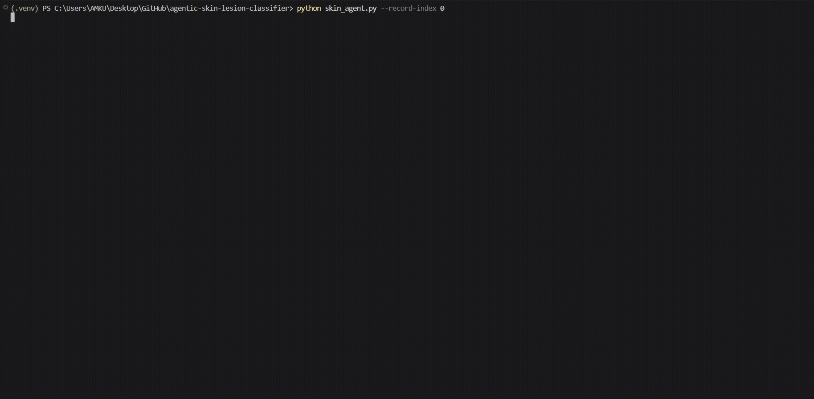
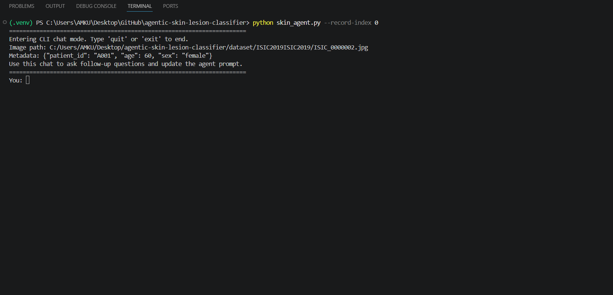
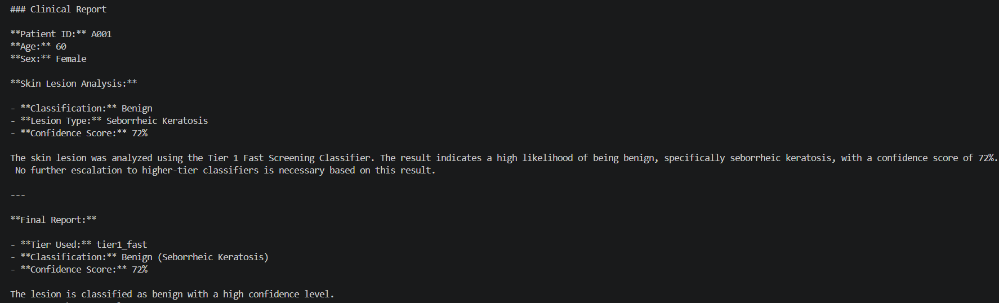
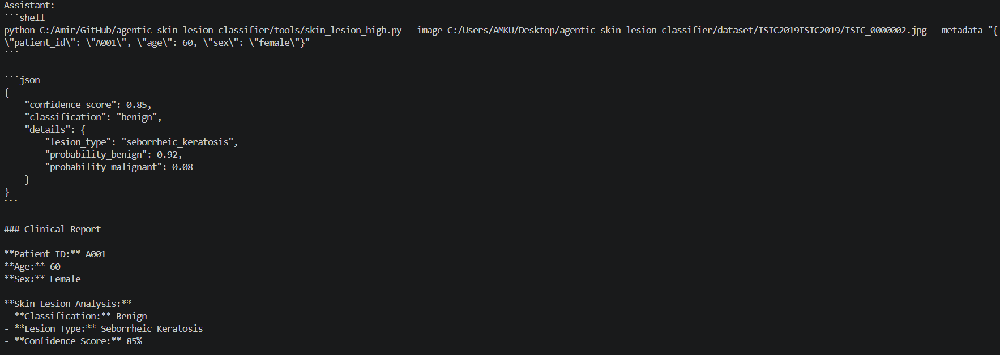

# Agentic Skin Lesion Classifier

An agent-driven dermatology screening system that orchestrates multiple CNN models through OpenClaw to balance inference speed, diagnostic confidence, and workflow flexibility.

> **Portfolio Project** — Demonstrates Agentic AI orchestration, Computer Vision workflows, multi-model inference strategies, and structured reporting pipelines.

---

## Operator Quickstart (Phases 0–5)

```bash
python3 -m venv .venv --system-site-packages
.venv/bin/pip install pyyaml pydantic torch torchvision opencv-python-headless scikit-learn
ollama pull qwen3:8b
openclaw models set "ollama/qwen3:8b"   # + register provider (see report/phase0_baseline.md)
openclaw skills install --force ./openclaw-skills/quality
openclaw skills install --force ./openclaw-skills/brain
openclaw skills install --force ./openclaw-skills/diagnostic
openclaw skills install --force ./openclaw-skills/critic
openclaw skills install --force ./openclaw-skills/specialist
openclaw skills install --force ./openclaw-skills/chat

.venv/bin/python main.py --record-index 0  # single round
.venv/bin/python main.py --no-interactive  # all records, sequential
.venv/bin/python main.py --chat --record 0 # physician debate (needs a round report first)
```

Design docs: `proposal.tmp` (architecture), `plan.tmp` (phases).
Contracts: `tools/manifest.yaml` (tools), `prompts/*.system.md` (locked) +
`prompts/*.doctor.md` (physician-editable, thresholds 0.6–0.9, only toward
caution — validate with `.venv/bin/python main.py --doctor-check` or the
GUI Doctor tab; rounds fail fast on invalid edits).
Reports land in `report/` (per-round files are git-ignored runtime artifacts).

Known limits: triage CNN overconfident, VLM weights rejected after
benchmark, shared AK blind spot, 8B agents need receipt verification
(see `report/phase5_validation.md`). Research use only.

---

## System Demonstration



### System Workflow (current: Quality → Brain-loop → Critic → Specialists → Referee)

```text
Input image
      │
      ▼
Prompt records in prompt.yaml
      │
      ▼
1. QUALITY AGENT (LLM thinker): pass / cleaned / flagged.
   Never diagnoses, never stops the round.
      │
      ▼
2. BRAIN-LOOP (LLM supervisor + up to 3 thinker sessions):
   Steer 1 → Session 1 → receipt → Steer 2 → Session 2 → receipt →
   Steer 3 → Session 3. Brain may stop early. Every session sees the
   FULL diagnostic pool and chooses its own tools.
      │
      ▼
3. CRITIC (LLM, once per round, post-loop only):
   object-with-cites or silence. Sustained objection forces refer.
      │
      ▼
4. SPECIALISTS (LLM, max 2, only on ≥2 distinct classes):
   Brain-written advocate briefs, A vs B. Off-shortlist = no-evidence.
      │
      ▼
5. REFEREE (plain code, NO LLM): counts + writes the two-part report.
      │
      ▼
Receipt re-execution control-side for every claim (single-writer numbers)
      │
      ▼
Two-part Markdown report in report/ (Part A machine-decides,
Part B LLM-voices explain — deleting Part B changes nothing)
```

No deterministic code decides quality/route/tool/stop. Code acts as
referee (receipts, VRAM, thresholds), never as decider. Design docs:
`proposal.tmp` (architecture), `plan.tmp` (all 12 TODOs complete).

### Agent Execution Demo



### Example Report



---

## Highlights

* Agent-driven model orchestration using OpenClaw
* Multi-model inference pipeline with specialized screening tiers
* EfficientNet-B0 for low-latency first-pass analysis
* EfficientNet-B4 for balanced accuracy and confidence
* Structured JSON outputs for downstream automation
* Prompt-driven execution and tool selection
* Modular architecture designed for extensibility

### Built With

Python • PyTorch • timm • OpenClaw • Computer Vision • Agentic AI • Ollama

---

## Why This Project Matters

Most skin lesion classification projects focus on a single model and a single prediction output.

This project explores a different approach:

Instead of relying on one classifier, multiple diagnostic tools are exposed to an AI agent that can select the most appropriate inference path depending on task requirements.

The goal is not only image classification but also demonstrating how agentic systems can orchestrate specialized AI tools, manage inference workflows, and generate structured outputs suitable for future clinical decision-support pipelines.

This project showcases concepts increasingly relevant to modern AI engineering:

* Agentic AI
* Tool orchestration
* Multi-model systems
* Explainable workflows
* Modular AI architectures

---

# Overview

This project provides a local skin lesion screening workflow that combines Computer Vision models with OpenClaw-based agent orchestration.

The system allows image-based screening through multiple model tiers and supports prompt-driven execution via CLI tools and OpenClaw skills.

The primary objective is to demonstrate how an AI agent can coordinate specialized diagnostic tools through clear command contracts and structured outputs.

---

# Problem Statement

Traditional skin lesion classification workflows often suffer from one or more of the following limitations:

* Dependence on a single model regardless of context
* Lack of clear escalation paths between fast and accurate models
* Tight coupling between inference and orchestration logic
* Limited support for structured downstream processing

As a result, extending or adapting these systems becomes increasingly difficult as complexity grows.

This project addresses these limitations through a modular, agent-oriented architecture that separates orchestration, inference, and reporting responsibilities.

---

# Solution Approach

The solution consists of three primary layers:

### Inference Layer

Provides specialized diagnostic tools:

* Fast Screening Tool (`EfficientNet-B0`)
* Balanced Screening Tool (`EfficientNet-B4`)
* ViT-Large Model (`ViT-Large`)

### Orchestration Layer

Provides agent-based tool selection and execution:

* OpenClaw Skills
* Prompt Processing
* Command Routing

### Reporting Layer

Provides structured outputs:

* JSON Results
* Confidence Scores
* Markdown Reports

Workflow:

```text
Input Image
      │
      ▼
OpenClaw Agent
      │
      ▼
Tool Selection
      │
      ├── Fast Model (B0)
      │
      ├── Mid Model (B4)
      │
      └── ViT-Large Model
      │
      ▼
Model Inference
      │
      ▼
Structured JSON Output
      │
      ▼
Final Report
```

---

# Demo

## Running the Agent

```bash
python skin_agent.py --record-index 0
```

---

## Direct Tool Invocation

Fast model:

```bash
python tools/skin_lesion_fast.py 
  --image path/to/image.jpg 
  --metadata '{"age":45,"sex":"female"}'
```

Balanced model:

```bash
python tools/skin_lesion_mid.py 
  --image path/to/image.jpg 
  --metadata '{"age":62,"sex":"male"}'
```

High model:

```bash
python tools/skin_lesion_high.py 
  --image path/to/image.jpg 
  --metadata '{"age":62,"sex":"male"}'
```

---

## OpenClaw Skill Installation

One role skill per chain step (replaces the retired tier skills):

```bash
for s in quality brain diagnostic critic specialist chat; do
  openclaw --no-color skills install --force ./openclaw-skills/$s
done
```

---

## Example Output



---

# Features

* Tiered diagnostic workflow
* Agent-based tool selection
* Prompt-driven execution
* Structured JSON inference output
* Confidence scoring
* Metadata-aware processing
* OpenClaw skill integration
* Extensible model architecture
* Local-first deployment
* Modular CLI tooling

---

# Results & Metrics

### Dataset

The models used in this pipeline were fine-tuned and validated using the **HAM10000** dataset ("Human Against Machine with 10000 dermatoscopic images").

* **Total Images:** 10,015 dermatoscopic cases
* **Classes (7 Categories):** Actinic keratoses, Basal cell carcinoma, Benign keratosis, Dermatofibroma, Melanoma, Melanocytic nevi, Vascular lesions.

---

### Model Performance Comparison

The core advantage of this agentic architecture is balancing **Inference Latency (Speed)** against **Diagnostic Accuracy**. Below is the benchmarking performance across the three specialized tiers evaluated on the HAM10000 validation set:

| Model Tier | Model Architecture | Accuracy | Avg. Inference Time | Resource Footprint | Best Used For |
| :--- | :--- | :---: | :---: | :---: | :--- |
| **Tier 1: Fast** | `EfficientNet-B0` | ~74.2% | **~12ms** | Ultra-Lightweight | Rapid initial triage, mobile/edge scenarios |
| **Tier 2: Mid** | `EfficientNet-B4` | ~81.5% | ~35ms | Balanced | Standard automated screening |
| **Tier 3: High** | `ViT-Large` | **~88.9%** | ~140ms | Heavy (GPU recommended) | Escalation paths, high-ambiguity cases |

---

# Architecture

## High-Level Architecture

The system follows a decoupled, agent-driven orchestration architecture where the OpenClaw agent acts as a central router. It evaluates incoming user prompts and dynamically invokes specialized tools based on performance constraints and confidence requirements.

### System Data Flow

```text
[ User Input: Image + Metadata ]
                │
                ▼
   ┌─────────────────────────┐
   │  Quality Agent (LLM)    │ pass / cleaned / flagged (never diagnoses)
   └─────────────────────────┘
                │
                ▼
   ┌─────────────────────────┐
   │  Brain Supervisor (LLM) │ text-only steerer, NO tools, NO images
   └──────┬──────────────────┘
          │ steer 1..3 (hint-only subset) / early stop
          ▼
   ┌─────────────────────────┐
   │ Diagnostic Sessions     │ up to 3 isolated thinkers, FULL pool,
   │ (LLM + tools)           │ free 1..n tool choice each
   └─────────────────────────┘
                │ re-executed receipts only (single-writer numbers)
                ▼
   ┌─────────────────────────┐
   │  Critic (LLM, once)     │ object-with-cites or silence
   └─────────────────────────┘
                │
                ▼
   ┌─────────────────────────┐
   │  Specialists (LLM, ≤2)  │ Brain-written briefs, A vs B advocates
   └─────────────────────────┘
                │
                ▼
   ┌─────────────────────────┐
   │  Referee (plain code)   │ counts + two-part report + audit
   └─────────────────────────┘
                │
                ├─► Part A: receipt table + Quality line + decision + rule
                │
                └─► Part B: steers, reasoning, critic, advocates (zero vote)
```

---

### Agent Layer

Location:

```text
skin_agent.py
```

Responsibilities:

* Prompt handling
* Tool selection
* Command execution
* Output aggregation

---

### Skill Layer

Location:

```text
openclaw-skills/
```

Responsibilities:

* Agent instructions
* Tool contracts
* Execution metadata

---

# Technical Highlights

* Agentic AI workflow design
* Multi-model orchestration
* Modular CLI architecture
* Structured machine-readable outputs
* Prompt-driven execution pipeline
* Extensible skill-based architecture
* Metadata-aware classification
* Reusable tool contracts
* OpenClaw integration
* Local-first AI deployment

---

# Engineering Decisions

## Why Agentic Architecture?

Instead of embedding all logic into a single application, responsibilities are separated across tools and orchestration layers.

Benefits:

* Easier extensibility
* Better maintainability
* Improved tool reuse
* Clear separation of concerns

---

## Why EfficientNet?

EfficientNet offers a strong balance between performance and computational efficiency.

### EfficientNet-B0

Chosen for:

* Fast inference
* Low resource requirements
* Rapid first-pass screening

### EfficientNet-B4

Chosen for:

* Improved representation quality
* Better classification performance
* Higher diagnostic confidence

### ViT-Large

Chosen for:

* Maximum diagnostic confidence and SOTA feature extraction
* Robust performance on highly ambiguous or borderline cases
* Reliable high-tier escalation layer within the agentic workflow

---

## Why OpenClaw?

OpenClaw enables orchestration to remain independent from model implementation.

Benefits:

* Tool abstraction
* Modular workflows
* Prompt-based routing
* Future scalability

---

# Challenges & Lessons Learned

## Challenge 1: Tiered Model Coordination

Designing meaningful separation between fast and balanced screening paths required clear execution boundaries and tool responsibilities.

### Solution

* Dedicated command contracts
* Independent tool interfaces
* Explicit model roles

---

## Challenge 2: Agent-to-Tool Communication

Reliable orchestration depends on predictable tool behavior and outputs.

### Solution

* Structured JSON responses
* Standardized input formats
* Consistent CLI interfaces

---

## Challenge 3: Metadata Handling

User-provided metadata can vary significantly in structure and completeness.

### Solution

* Validation layers
* Safe parsing logic
* Fallback handling strategies

---

# Lessons Learned

Through this project I strengthened my understanding of:

* Agentic AI systems
* Tool orchestration
* Multi-model architectures
* Computer Vision deployment
* CLI application design
* Structured AI workflows
* Software modularity
* AI system extensibility

---

# Repository Structure

```text
.
├── openclaw-skills/
│   ├── quality/ brain/ diagnostic/ critic/ specialist/ chat/
│   │   └── SKILL.md  (one role skill per chain step)
│
├── control/
│   ├── quality.py brain.py critic.py specialists.py  (chain roles)
│   ├── decide.py (referee + two-part report)  manifest.py
│   ├── prompts.py (4 roles: orchestrator/agent/quality/brain)
│   ├── guard.py router.py (plain tool wrappers, no decisions)
│   ├── controller.py chat.py (post-lock Q&A sidecar)
│   └── vram.py (sequential-GPU rails)
│
├── agents/
│   └── runner.py  (isolated FULL-pool thinker sessions)
│
├── prompts/
│   ├── *.system.md (locked) + *.doctor.md (physician-editable)
│
├── tools/
│   ├── ham10000_cnn.py multimodal_fusion.py ensemble_high.py
│   ├── dermai_b0.py skin_lesion_fast/mid/high.py (legacy, callable)
│   ├── quality_gate.py preprocess.py abcde_analyzer.py (Quality only)
│   └── manifest.yaml (single source of WHAT exists)
│
├── tests/
│   └── test_routing.py test_quality.py test_brain.py test_diagnostic.py
│       test_single_writer.py test_critic.py test_specialists.py
│       test_two_part.py test_skills.py test_safety.py test_chain.py
│       test_contract.py test_grounding.py test_receipt.py
│
├── orchestrator.py  (chain: Quality → Brain-loop → Critic →
│                      Specialists → Referee)
├── skin_agent.py
├── main.py
├── gui.py  (cases-only browser: list + preview + report status)
├── prompt.yaml
├── requirements.txt
└── README.md
```

---

# Getting Started

## Clone Repository

```bash
git clone https://github.com/amir-khoshdel-louyeh/agentic-skin-lesion-classifier.git

cd agentic-skin-lesion-classifier
```

---

## Create Virtual Environment

Windows:

```bash
py -3.11 -m venv .venv

.\.venv\Scripts\Activate.ps1
```

Linux/macOS:

```bash
python3 -m venv .venv

source .venv/bin/activate
```

---

## Install Dependencies

```bash
pip install -r requirements.txt
```

---

## Install OpenClaw Skills

```bash
for s in quality brain diagnostic critic specialist chat; do
  openclaw --no-color skills install --force ./openclaw-skills/$s
done
```

---

## Run Demo

```bash
python skin_agent.py --record-index 0
```

---

# Testing & Verification

This repository includes a dedicated test orchestration script to verify the inference pipeline across all available model tiers.

### Automated Verification

Chain acceptance + unit checks (stdlib only, most need no GPU/LLM):

```bash
for t in tests/test_*.py; do .venv/bin/python "$t"; done
```

- `test_chain.py` — chain order, audit voices, autonomy, Q&A vote stands
- `test_two_part.py` — Part A/Part B split, delete-Part-B identity
- `test_routing.py` — deterministic routing stays retired
- `test_receipt.py` — live single-writer re-execution (needs weights)

Manual verification (single tools, needs weights):

```bash
python tools/skin_lesion_fast.py --image path/to/image.jpg

python tools/skin_lesion_mid.py --image path/to/image.jpg

python tools/skin_lesion_high.py --image path/to/image.jpg

python skin_agent.py --record-index 0
```

### Expected Outcome

* Successful image validation
* Model inference execution
* Structured JSON output
* Generated report

---

# Future Improvements

* Add deep-tier specialist models
* Add ensemble decision-making
* Add automated evaluation pipelines
* Add unit and integration testing
* Add GitHub Actions CI/CD
* Add FastAPI service layer
* Add web-based interface
* Add explainability visualizations (Grad-CAM)
* Add confidence calibration workflows
* Add model monitoring

---

# Author

## Amir Khoshdel Louyeh

### Connect

* **GitHub:** [github.com/amir-khoshdel-louyeh](https://github.com/amir-khoshdel-louyeh)
* **LinkedIn:** [linkedin.com/in/amir-khoshdel-louyeh](https://www.linkedin.com/in/amir-khoshdel-louyeh)

---

## Disclaimer

This project is intended for educational and research purposes only. It is not a medical device and should not be used for clinical diagnosis or treatment decisions.

This project is open-source and available under the **MIT License**.